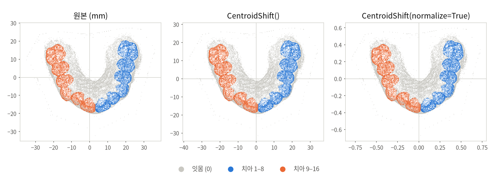
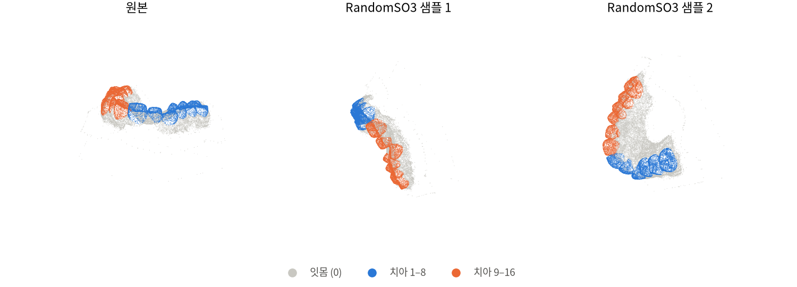
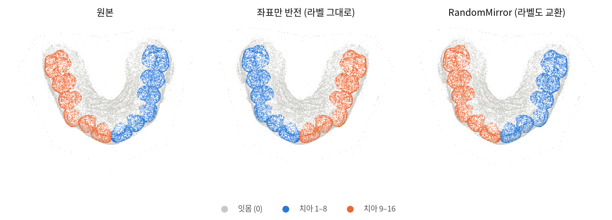
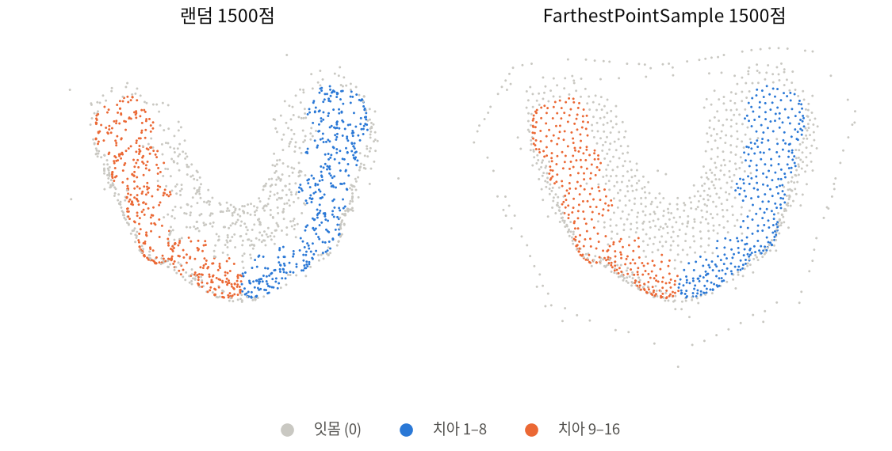
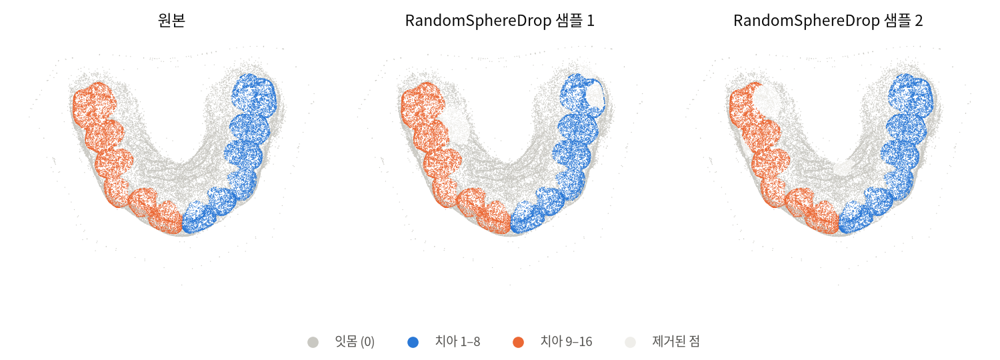
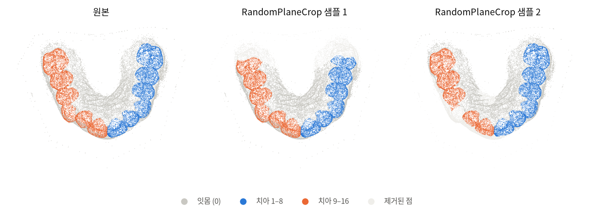
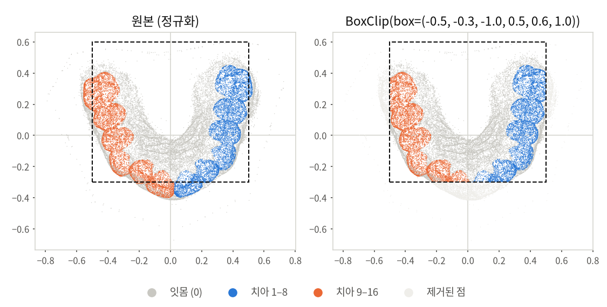

# 3D 포인트 클라우드 데이터 증강

`augmentation/`에 있는 치아 스캔용 데이터 증강 알고리즘을 설명합니다.
파일 하나에 알고리즘 하나가 들어 있고, 모두 Pointcept의 `TRANSFORMS`에 등록되어 있어서 config에서 `dict(type="클래스명", ...)`으로 바로 쓸 수 있습니다.

| 클래스 | 파일 | 종류 | 한 줄 요약 |
|---|---|---|---|
| `CentroidShift` | `centroid_shift.py` | 정규화 | 무게중심을 원점으로 옮기고, 원하면 단위 구 안으로 크기를 맞춤 |
| `RandomSO3` | `random_so3.py` | 기하 변환 | 3차원 전방향 랜덤 회전 |
| `RandomMirror` | `random_mirror.py` | 기하 변환 | 좌우 반전 + 치아 라벨 좌우 교환 |
| `FarthestPointSample` | `farthest_point_sample.py` | 다운샘플 | 전체를 고르게 덮는 N개 점 선택 |
| `RandomSphereDrop` | `random_sphere_drop.py` | 점 제거 | 랜덤 구 안의 점 제거 (스캔 구멍) |
| `RandomPlaneCrop` | `random_plane_crop.py` | 점 제거 | 랜덤 평면 한쪽 제거 (부분 스캔) |
| `BoxClip` | `clip.py` | 점 제거 | 바운딩박스 밖의 점 제거 |

## 공통 규칙

- 입력과 출력은 Pointcept의 `data_dict`입니다. 점마다 값이 있는 numpy 배열(`coord` (N, 3), `normal`, `segment`, `instance` 등)과 스캔 단위 값(`name` 등)이 들어 있습니다.
- 랜덤 증강은 `p` 확률로만 적용됩니다.
- 점을 지우거나 고르는 증강(다운샘플, 점 제거)은 Pointcept의 `index_operator`를 사용합니다. 그래서 `data_dict["index_valid_keys"]`에 있는 key(`coord`, `normal`, `segment`, `instance` …)가 모두 같은 인덱스로 함께 잘리고, 점과 라벨의 짝이 어긋나지 않습니다.
- 랜덤 값은 전역 `random` / `np.random`에서 뽑습니다. Pointcept의 `worker_init_fn`이 DataLoader worker마다 다른 seed를 주므로 worker끼리 같은 증강이 나오지 않습니다.
- 등록은 `tools/train.py`, `tools/test.py`의 `import augmentation`에서 일어납니다. 새 증강을 만들면 `augmentation/__init__.py`에 import를 한 줄 추가하세요.

라벨은 17클래스 규칙을 따릅니다(`toothseg3d/t3ds_io.py`의 `fdi_to_class`).

| 클래스 | 의미 |
|---|---|
| 0 | 잇몸 |
| 1–8 | 한쪽 치아 (중절치 → 제3대구치) |
| 9–16 | 반대쪽 치아 (중절치 → 제3대구치) |

아래 그림은 공개 데이터셋 Teeth3DS의 상악 스캔 `013ZD6EX`에서 랜덤으로 3만 점을 뽑아, 위(교합면)에서 내려다본 모습입니다.

---

## CentroidShift

스캔마다 위치와 크기가 다른 것을 맞춰 주는 정규화입니다. 랜덤 요소는 없습니다.

- **중심 이동**: 모든 점에서 점들의 평균을 뺍니다.

  $$x_i \leftarrow x_i - \frac{1}{N}\sum_j x_j$$

- **`normalize=True`**: 중심 이동 뒤, 원점에서 가장 먼 점까지의 거리로 나눠 모든 점을 반지름 1인 구 안에 넣습니다.

  $$x_i \leftarrow \frac{x_i}{\max_j \lVert x_j \rVert}$$

  모든 축을 같은 비율로 줄이므로 `normal`은 바뀌지 않습니다.

```python
dict(type="CentroidShift", normalize=False)
```



> **주의**: `normalize=True`를 쓰면 실제 크기(mm)가 사라집니다. 그 뒤에 오는 `GridSample(grid_size)`, `RandomJitter(sigma)` 같은 길이 값도 정규화된 단위로 해석됩니다.

## RandomSO3

3차원의 모든 방향 중에서 균등하게 회전 하나를 뽑아 적용합니다. 스캐너 자세나 정렬 상태가 제각각인 입력에 강건해지도록 하는 용도입니다.

- 회전 행렬 $R$은 `scipy`의 `Rotation.random()`으로 뽑습니다. 크기 1인 랜덤 쿼터니언을 쓰기 때문에 회전 공간 SO(3) 위에서 균등합니다.
- 좌표는 중심 $c$를 기준으로 돌립니다: $x' = (x - c)R^\top + c$. normal도 같은 $R$로 돌립니다.
- `center=None`이면 bbox 중심을 기준으로 돌립니다.
- Pointcept의 `RandomRotate`는 한 축(x/y/z)만 돌린다는 점이 다릅니다.

```python
dict(type="RandomSO3", center=None, p=1.0)
```



## RandomMirror

좌우를 반전하면서 치아 라벨도 반대편으로 바꿉니다.

- **좌표와 normal**: `axis` 성분의 부호를 뒤집습니다($x \leftarrow -x$).
- **라벨**: 1–8은 +8, 9–16은 −8로 바꿉니다. 잇몸(0)과 무시 라벨(−1)은 그대로 둡니다.
- **라벨을 같이 바꾸는 이유**: 좌표만 뒤집으면 오른쪽 치아가 왼쪽 라벨을 갖게 됩니다(아래 가운데 그림). 그런 데이터로 학습하면 모델이 좌우를 구분하지 못합니다. Pointcept의 `RandomFlip`이 이렇게 좌표만 뒤집으므로, 치아 데이터에는 쓰지 마세요.
- **전제**: `axis`가 좌우 방향이어야 합니다. Teeth3DS와 `toothseg3d/align.py`로 정렬한 데이터는 x축(`axis=0`)이 좌우입니다.

```python
dict(type="RandomMirror", axis=0, teeth_per_side=8, p=0.5)
```



> **순서**: `RandomSO3`보다 **앞에** 두세요. 회전 후에는 x축이 더 이상 좌우 방향이 아닙니다.

## FarthestPointSample

FPS(Farthest Point Sampling)로 `num_points`개의 점을 고릅니다.

- 랜덤 점 하나에서 시작합니다.
- 매 단계에서 "이미 고른 점들까지의 최소 거리"가 가장 큰 점을 하나 추가합니다.
- 이렇게 하면 랜덤 샘플링과 달리 빈 곳 없이 전체 표면을 고르게 덮습니다.

$$i_k = \arg\max_i \; \min_{j<k} \lVert x_i - x_{i_j} \rVert$$

- 계산량은 $O(N \cdot M)$입니다. numpy 구현으로 점 10만 개 → 1.6만 개에 약 1–2초가 걸립니다. 학습 중 매번 돌리기보다는 전처리에서 한 번 적용하는 쪽을 권합니다.
- 점 수가 이미 `num_points` 이하면 아무것도 하지 않습니다.

```python
dict(type="FarthestPointSample", num_points=16000)
```



> 그림처럼 FPS는 먼 점을 우선해서 고르기 때문에, 스캔 가장자리에 흩어진 이상치를 많이 고릅니다. 이상치가 많은 스캔이라면 `BoxClip` 등으로 먼저 정리한 뒤 적용하세요.

## RandomSphereDrop

랜덤한 위치에 구를 놓고 그 안의 점을 지워서, 스캔 중 생기는 구멍(반사, 가려짐, 침 등)을 흉내 냅니다.

- 구의 개수는 `num_spheres` 범위에서 뽑습니다.
- 중심은 랜덤한 점 위치입니다.
- 반지름은 $r = u \cdot \text{bbox 대각선 길이}$이고, $u$는 `radius_ratio` 범위에서 뽑습니다.
- 반지름이 스캔 크기에 비례하므로 정규화 여부와 상관없이 같은 정도로 동작합니다.

```python
dict(type="RandomSphereDrop", num_spheres=(1, 3), radius_ratio=(0.02, 0.05), p=0.5)
```



그림은 구 3개를 놓은 경우(`num_spheres=(3, 3)`)입니다. 연한 회색이 지워진 점입니다.

## RandomPlaneCrop

랜덤한 평면으로 스캔의 한쪽을 잘라서, 구치부 같은 일부 영역이 빠진 부분 스캔을 흉내 냅니다.

- 방향 $d$는 3차원 가우시안 벡터를 정규화해서 뽑습니다. 이렇게 하면 모든 방향이 같은 확률로 나옵니다.
- 각 점의 높이 $h_i = x_i \cdot d$를 계산합니다.
- 제거 비율 $q \sim U(0, \text{max\_drop\_ratio})$를 뽑아, 높이가 상위 $q$ 비율에 드는 점을 지웁니다.
- 높이의 분위수로 자르기 때문에 지워지는 점의 비율이 스캔 크기와 상관없이 정확히 조절됩니다.

```python
dict(type="RandomPlaneCrop", max_drop_ratio=0.3, p=0.3)
```



## BoxClip

축에 평행한 박스 `(x_min, y_min, z_min, x_max, y_max, z_max)` 밖의 점을 **지웁니다**. 랜덤 요소는 없습니다.

- 관심 영역만 남기거나 멀리 떨어진 이상치를 정리할 때 씁니다.
- Pointcept의 `PointClip`은 박스 밖의 점을 지우지 않고 좌표를 박스 범위 안으로 자릅니다. 그러면 바깥 점들이 박스 표면에 몰리기 때문에, 이 클래스는 지우는 방식으로 만들었습니다.

```python
dict(type="BoxClip", box=(-1, -1, -1, 1, 1, 1))
```



---

## 권장 순서

```python
transform = [
    dict(type="CentroidShift", normalize=True),
    dict(type="RandomMirror", axis=0, p=0.5),             # 회전 전에 (x축 = 좌우일 때)
    dict(type="RandomSO3", p=1.0),
    dict(type="RandomPlaneCrop", max_drop_ratio=0.3, p=0.3),
    dict(type="RandomSphereDrop", p=0.5),
    dict(type="BoxClip", box=(-1, -1, -1, 1, 1, 1)),
    # GridSample, ToTensor, Collect ...
]
```

- **정규화를 맨 앞에**: 뒤에 오는 증강의 길이 값(박스 크기 등)이 모든 스캔에서 같은 의미를 갖습니다.
- **`RandomMirror`는 `RandomSO3`보다 앞에**: 회전하면 x축이 더 이상 좌우 방향이 아닙니다.
- **점 제거는 기하 변환 뒤에**: 순서를 바꿔도 결과 분포는 비슷하지만, 박스·평면 기준을 회전된 좌표에서 해석하는지 여부가 달라집니다.

## 그림 다시 만들기

각 증강 파일에는 그 증강의 그림을 그리는 `visualize()`가 들어 있고, 파일을 직접 실행하면 이 함수가 호출됩니다. Pointcept 환경에서, Pointcept 루트(`model/Pointcept`)에서 실행합니다.

```bash
PYTHONPATH=./ python augmentation/random_so3.py                     # 기본 예시 스캔 (Teeth3DS 013ZD6EX)
PYTHONPATH=./ python augmentation/random_so3.py <Teeth3DS .obj 경로>  # 다른 스캔
```

- 다른 스캔을 쓸 때는 같은 이름의 `.json`(Teeth3DS 라벨 파일)이 옆에 있어야 합니다.
- 그림은 `augmentation/figures/<파일 이름>.png`에 저장됩니다.
- 공통 그리기 함수는 `plot_utils.py`에 있습니다. `visualize()` 안에서만 import하므로, 학습할 때는 matplotlib을 불러오지 않습니다.
- `python -m augmentation.random_so3`로 실행하면 안 됩니다. 패키지 `__init__`이 같은 클래스를 한 번 더 등록해서 `KeyError: ... is already registered`가 납니다.
